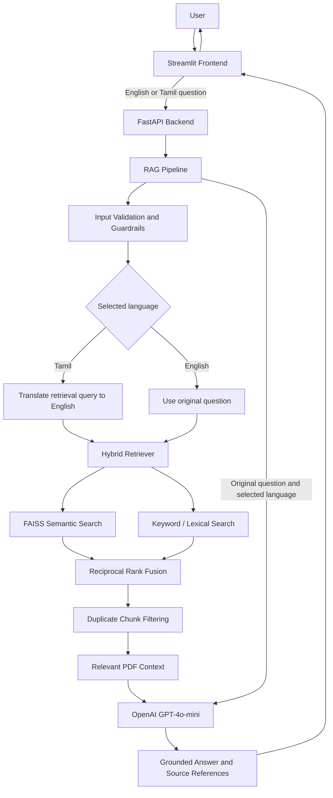
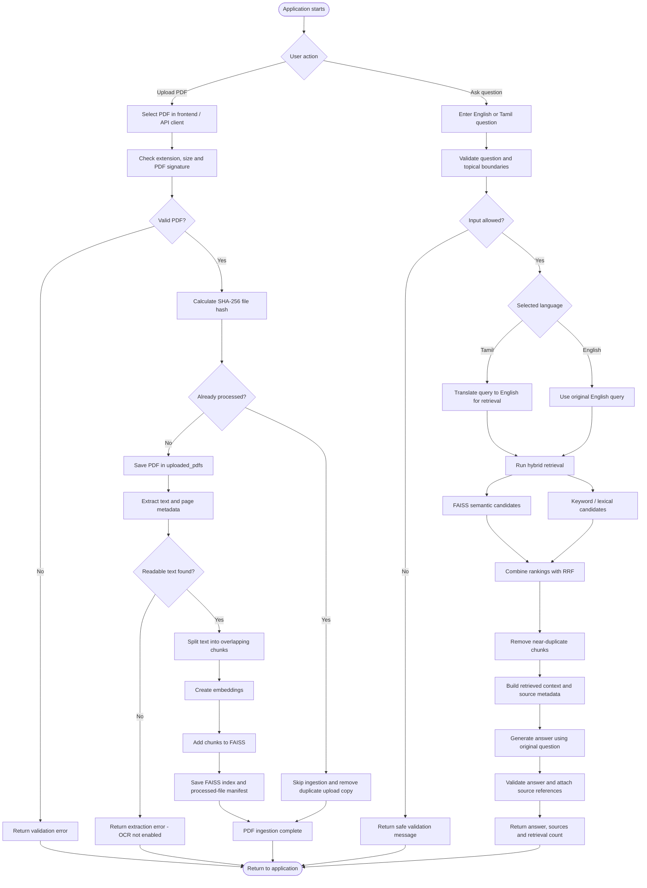

# Tamil Nadu Farmers AI Assistant

A bilingual Retrieval-Augmented Generation (RAG) application that helps users find information about Tamil Nadu farmer welfare schemes, subsidies, benefits, and application guidance from uploaded PDF reference documents.

The application combines a **Streamlit** user interface, **FastAPI** backend, **LangChain**, **OpenAI GPT-4o-mini**, **OpenAI text-embedding-3-small**, and a persistent **FAISS** vector index. It supports English and Tamil questions.

> **Important:** Answers are based on the documents available to the application. Users should verify scheme rules, eligibility, subsidy amounts, deadlines, and application procedures with the relevant Tamil Nadu government department.

---

## 1. Main capabilities

- Ask farmer-scheme questions in English or Tamil.
- Translate Tamil questions into English for retrieval from English-language PDF content; preserve the original question for Tamil answer generation.
- Retrieve relevant passages using hybrid retrieval:
  - semantic retrieval through FAISS embeddings;
  - keyword/lexical retrieval;
  - Reciprocal Rank Fusion (RRF) to combine ranked results;
  - near-duplicate chunk filtering.
- Generate grounded answers with an OpenAI chat model.
- Display source PDF filenames and page references with answers.
- Upload PDF documents through the FastAPI endpoint.
- Validate uploaded file type, PDF signature, and maximum file size.
- Detect previously processed PDFs using a SHA-256 file hash and avoid adding duplicate chunks.
- Display the backend PDF inventory in the Streamlit sidebar when the corresponding `/uploaded-pdfs` API endpoint is implemented and enabled.
- Keep chat history during the current Streamlit session.
- Provide a clear-chat action and language selector.

## 2. Technology stack

| Layer | Technology | Responsibility |
|---|---|---|
| Frontend | Streamlit | Chat UI, language selector, PDF inventory display, source display |
| Backend | FastAPI | Chat and PDF upload APIs |
| RAG orchestration | LangChain | Prompt construction and model integration |
| Chat model | OpenAI GPT-4o-mini | Answer generation and Tamil-query translation |
| Embeddings | OpenAI text-embedding-3-small | Convert document chunks and queries into vectors |
| Vector database | FAISS | Persistent semantic similarity search |
| PDF processing | PyPDF / LangChain PDF loader | Extract text and page metadata |
| Text splitting | RecursiveCharacterTextSplitter | Split extracted text into overlapping chunks |
| Configuration | python-dotenv | Load API key and model configuration from `.env` |

## 3. High-level architecture



## 4. High-level application flowchart

The following flow shows the two main workflows: **PDF ingestion** and **question answering**.



## 5. RAG workflow explained

### A. PDF ingestion workflow

1. A PDF is submitted to the FastAPI `/upload-pdf` endpoint.
2. The backend checks the `.pdf` extension, the configured maximum size (25 MB), and the PDF file signature.
3. The application calculates a SHA-256 hash.
4. If that hash already exists in the processed-file manifest, ingestion is skipped to prevent duplicate indexing.
5. For a new PDF, the PDF loader extracts readable text and page metadata.
6. The text splitter creates chunks using a configured chunk size of 1,000 characters and overlap of 200 characters.
7. OpenAI embeddings convert the chunks into vectors.
8. The vectors and their document metadata are added to FAISS.
9. The FAISS index is persisted locally and the processed-file manifest is updated.

**Current PDF limitation:** OCR is not enabled. Image-only/scanned PDFs without extractable text are rejected rather than silently indexed as empty content.

### B. Question-answering workflow

1. The user selects English or Tamil and submits a question in Streamlit.
2. Streamlit sends the question and selected language to FastAPI `/chat`.
3. The input guard checks the question.
4. For Tamil, the pipeline translates the question into English for retrieval. The original Tamil question is retained.
5. The retriever searches the FAISS index semantically and performs keyword/lexical retrieval.
6. Reciprocal Rank Fusion combines the result rankings.
7. Near-duplicate chunks are filtered.
8. The pipeline passes the original question and retrieved document context to the answer generator.
9. GPT-4o-mini is instructed to answer only from the supplied context and in the user's selected language.
10. The response is returned with source filenames and page references.
11. Streamlit displays the answer and a **View Sources** section.

## 6. Project structure

The project has been organized into frontend, backend, data, vector database, and test modules. The following is the intended structure; some folders may contain additional modules as development continues.

```text
TN_FARMERS_RAG_ASSISTANT/
│
├── backend/
│   ├── main.py
│   ├── routes/
│   ├── rag/
│   │   ├── pdf_loader.py
│   │   ├── text_splitter.py
│   │   ├── embeddings.py
│   │   ├── vector_store.py
│   │   ├── retriever.py
│   │   ├── generator.py
│   │   ├── ingestion.py
│   │   └── pipeline.py
│   └── guardrails/
│       ├── input_guard.py
│       └── output_guard.py
│
├── frontend/
│   └── app.py
│
├── data/
│   ├── uploaded_pdfs/
│   └── scraped_data/
│
├── vector_db/
│   └── faiss_index/
│
├── tests/
│
├── .env
├── .gitignore
├── requirements.txt
└── README.md
```

## 7. Configuration

Create a `.env` file in the project root:

```env
OPENAI_API_KEY=your_openai_api_key
OPENAI_MODEL=gpt-4o-mini
EMBEDDING_MODEL=text-embedding-3-small
FAISS_INDEX_PATH=vector_db/faiss_index
```

- Replace the placeholder with your own API key locally.
- Do not commit `.env` to GitHub.
- Do not paste API keys into source code or share them in screenshots.

## 8. Installation and setup (Windows Command Prompt)

Open Command Prompt in the project directory:

```cmd
cd C:\LEARNINGS\DAY_TODAY\TN_FARMERS_RAG_ASSISTANT
```

Create and activate a virtual environment if one does not already exist:

```cmd
python -m venv venv
venv\Scripts\activate.bat
```

Install dependencies:

```cmd
pip install -r requirements.txt
```

Configure the `.env` file as described above.

## 9. Run the application

Open **two terminals** in VS Code. Activate the virtual environment in each terminal.

**Terminal 1 — FastAPI backend**

```cmd
uvicorn backend.main:app --reload
```

Backend URLs:

- API home: `http://127.0.0.1:8000/`
- Health check: `http://127.0.0.1:8000/health`
- Swagger API documentation: `http://127.0.0.1:8000/docs`

**Terminal 2 — Streamlit frontend**

```cmd
streamlit run frontend/app.py
```

Open the local URL printed by Streamlit, usually `http://localhost:8501`.

## 10. API endpoints

| Method | Endpoint | Purpose |
|---|---|---|
| GET | `/` | API welcome/status response |
| GET | `/health` | Check API health and whether the FAISS index path exists |
| POST | `/chat` | Submit a question and language; receive an answer and source references |
| POST | `/upload-pdf` | Validate, save and ingest a PDF |

### Chat request example

```json
{
  "question": "What subsidy is available for gypsum distribution?",
  "language": "English"
}
```

Tamil example:

```json
{
  "question": "ஜிப்சம் பயன்படுத்துவதற்கு என்ன மானியம் வழங்கப்படுகிறது?",
  "language": "தமிழ்"
}
```

### PDF upload

Use `POST /upload-pdf` with a multipart form field named `file` containing the PDF.

### PDF inventory endpoint note

The Streamlit sidebar can request `GET /uploaded-pdfs` to list files, sizes and upload times. This endpoint must be implemented in `backend/main.py` before that sidebar feature can work. The core API endpoint list above does not assume that it is already present.

## 11. Testing and verification

The project has been tested in stages, including:

- PDF loading and page extraction.
- Text splitting and metadata retention.
- OpenAI embedding initialization.
- FAISS index loading and persistence.
- Retriever execution and hybrid retrieval.
- RAG answer generation.
- Pipeline and API chat requests.
- PDF upload and duplicate-file detection.

At the last recorded index check, the FAISS index contained **704 vectors** (696 chunks from `farmer_scheme.pdf` and 8 chunks from `tamilnadu.pdf`). This is a development-time snapshot; the count changes when new PDFs are successfully ingested.

Example vector-count check:

```cmd
python -c "from backend.rag.vector_store import load_vector_store; db=load_vector_store(); print('Total indexed vectors:', db.index.ntotal)"
```

Example retriever test:

```cmd
python -m tests.test_retriever
```

Run the available test modules from the project root using their actual filenames in the `tests` package.

## 12. Security and reliability notes

- Keep `.env`, API keys, and private configuration out of source control.
- Treat uploaded PDFs as untrusted reference content.
- The answer-generation prompt instructs the model not to follow instructions embedded in retrieved documents.
- Input and output guardrails provide application-level checks; they are not a guarantee against every prompt-injection or inaccurate-answer scenario.
- FAISS local persistence uses a deserialization option that should only be used with an index created and controlled by this application. Never load an untrusted FAISS folder.
- The current local development setup is not a production deployment. Production use needs authentication, authorization, upload-rate limits, stronger file scanning, robust logging, backups, and deployment-specific secret management.
- Retrieved source references show which documents were used, but they do not independently prove every sentence in an answer. Check the cited PDF page and official government source before acting on scheme information.

## 13. Known limitations

- OCR for scanned/image-only PDFs is not enabled.
- Retrieval quality depends on the text quality and completeness of uploaded documents.
- Tamil retrieval currently uses English translation as a search aid; quality can be affected by translation and PDF text extraction.
- A source page can contain several schemes or adjacent table rows; inspect the page context when confirming a specific benefit.
- The local FAISS index and uploaded PDFs are stored on the machine running the backend.
- The PDF inventory UI requires the `/uploaded-pdfs` endpoint to be implemented.

## 14. Future enhancements

- Implement and secure the `/uploaded-pdfs` inventory endpoint.
- Add PDF removal and re-index controls with safeguards.
- Improve table-aware PDF extraction and Tamil text quality.
- Add OCR as an optional, explicitly configured feature for scanned documents.
- Add official Tamil Nadu government website ingestion and scheduled refresh.
- Add stronger metadata filtering and retrieval evaluation with a curated question-answer test set.
- Add authentication, user roles, audit logs, and production deployment.
- Explore Knowledge Graph / Neo4j integration if required by the broader project roadmap.

---

## Project summary

The Tamil Nadu Farmers AI Assistant is a bilingual, PDF-grounded RAG application. It processes farmer-scheme documents into searchable chunks, retrieves relevant passages using semantic and lexical search, and uses an LLM to produce a concise answer with document and page references. Its goal is to make information in the available reference documents easier to discover—not to replace official government guidance.
